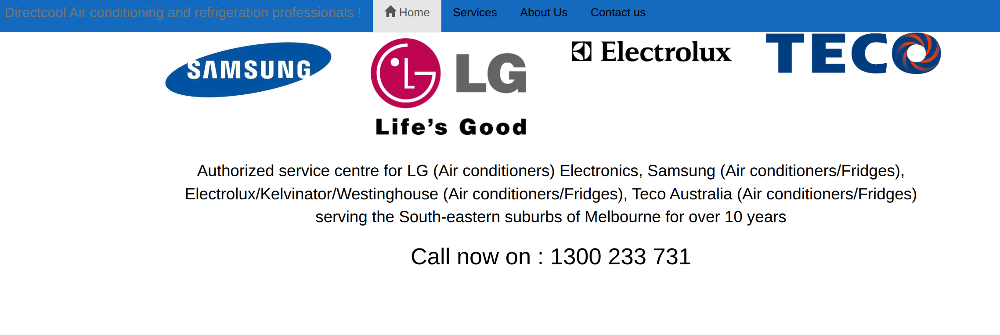
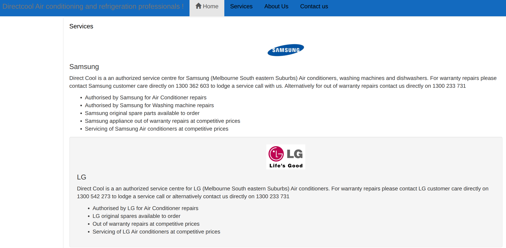
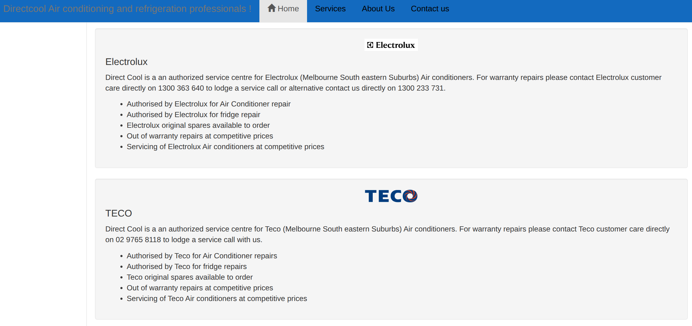
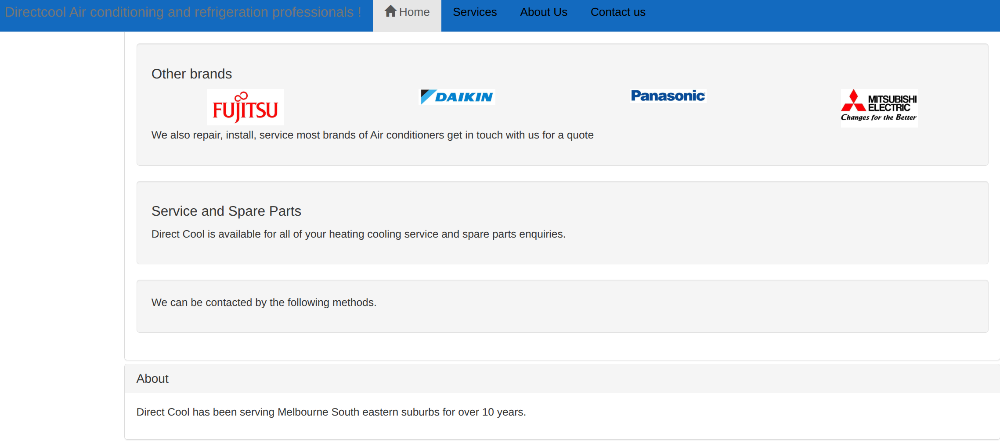

# Direct Cool – Business Website

A responsive business website developed for Direct Cool, an air conditioning and refrigeration service business based in Melbourne, Australia.

## Table of Contents

- [Overview](#overview)

- [Features](#features)

- [Screenshots](#screenshots)

- [Tech Stack](#tech-stack)

- [Architecture](#architecture)

- [Getting Started](#getting-started)
  - [Prerequisites](#prerequisites)

  - [Installation](#installation)

- [Project Structure](#project-structure)

- [Available Scripts](#available-scripts)

- [Development](#development)

- [Testing](#testing)

- [Deployment](#deployment)

- [Troubleshooting](#troubleshooting)

- [Contributing](#contributing)

- [License](#license)

- [Acknowledgements](#acknowledgements)

- [Contact](#contact)

---

## Overview

Direct Cool is a business website developed for a local air conditioning and refrigeration service business based in Melbourne, Victoria, Australia.

The website provides an online presence for the business, presenting its services, authorised service centre information, supported appliance brands and contact details.

The project focuses on providing a straightforward and responsive user experience, allowing visitors to navigate business information, explore available services and find contact information.

This project was developed as part of a previous professional engagement.

**Project Status:** Completed (Legacy Project completed in 2016)

The original company-hosted version is no longer maintained.

## Features

- **Responsive Layout:** Uses Bootstrap's responsive grid system to accommodate different screen sizes.

- **Navigation:** Provides navigation links to the Home, Services, About and Contact sections.

- **Service Information:** Displays air conditioning, refrigeration and appliance repair services.

- **Brand Information:** Showcases authorised service centre information for Samsung, LG, Electrolux and TECO.

- **Additional Brands:** Displays other supported appliance brands, including Fujitsu, Daikin, Panasonic and Mitsubishi.

- **Business Information:** Presents company information, operating hours and contact details.

- **Contact Options:** Provides business contact information, including telephone numbers and an email link.

- **Collapsible Navigation:** Uses Bootstrap components to support responsive navigation.

## Screenshots

<p align="center">
  
</p>

<p align="center">
  
</p>

<p align="center">
  
</p>

<p align="center">
  
</p>

## Tech Stack

| Category             | Technology             |
| -------------------- | ---------------------- |
| Markup               | HTML5                  |
| Styling              | CSS3                   |
| CSS Framework        | Bootstrap 3.3.6        |
| JavaScript Library   | jQuery 2.2.3           |
| Programming Language | JavaScript             |
| Fonts                | Local font assets      |
| Hosting              | Static website hosting |
| Package Manager      | Not applicable         |

### Dependencies

The project uses locally stored frontend dependencies:

- Bootstrap 3.3.6

- jQuery 2.2.3

- Bootstrap JavaScript components

No Node.js dependencies or package manager configuration are required.

## Architecture

The application follows a static, client-side architecture.

HTML provides the website structure and content, CSS handles styling and layout customisation, and JavaScript powers interactive interface components.

Bootstrap provides the responsive grid system and interface components, while jQuery supports Bootstrap's JavaScript functionality.

### Main Components

| Component       | Responsibility                               |
| --------------- | -------------------------------------------- |
| `index.html`    | Main website structure and content           |
| `IndexOld.html` | Previous HTML implementation                 |
| `css/`          | Bootstrap stylesheets and custom CSS         |
| `js/`           | jQuery, Bootstrap and JavaScript components  |
| `images/`       | Business branding and appliance brand images |
| `fonts/`        | Local font assets                            |

There is no backend application, database or server-side API associated with this project.

## Getting Started

### Prerequisites

The project has minimal setup requirements.

- A modern web browser.

- Git (optional, for cloning the repository).

No Node.js runtime, package manager or database is required.

### Installation

1.  Clone the repository:

    ```
    git clone https://github.com/amalk-au/directcool-business-website.git
    ```

2.  Navigate to the project directory:

    ```
    cd directcool-business-website
    ```

3.  Open `index.html` in your preferred web browser.

The website uses relative paths for its stylesheets, scripts and image assets, so the existing directory structure should be preserved.

## Project Structure

```
directcool-business-website/
├── css/
│   ├── bootstrap.min.css
│   └── dc.css
├── fonts/
├── images/
├── js/
│   ├── jquery-2.2.3.min.js
│   ├── bootstrap.min.js
│   ├── transition.js
│   └── collapse.js
├── docs/
│   └── screenshots/
├── IndexOld.html
├── index.html
├── .gitattributes
├── LICENSE
└── README.md
```

**Note:** The `docs/screenshots/` directory is reserved for screenshots and can be created when adding project documentation images.

## Available Scripts

This project does not currently use a package manager or build system.

There are no configured npm or pnpm scripts.

The website consists of static HTML, CSS, JavaScript and asset files that can be served directly by a web server.

| Command        | Description                        |
| -------------- | ---------------------------------- |
| Not applicable | No package scripts are configured. |

## Development

The project uses a straightforward static website structure.

When making changes:

1.  Modify the HTML structure in `index.html`.

2.  Update custom styles in `css/dc.css`.

3.  Update JavaScript functionality in the relevant files under `js/`.

4.  Keep existing asset references and relative paths intact.

5.  Test changes across desktop and mobile screen sizes.

6.  Verify navigation links and interactive Bootstrap components.

### Development Guidelines

- Maintain the existing project structure.

- Use semantic HTML where possible.

- Keep custom styles separate from framework styles.

- Preserve responsive behaviour.

- Avoid introducing unnecessary dependencies.

- Verify that local assets load correctly after changes.

## Testing

No automated testing framework is configured.

Testing should be performed manually using a web browser.

### Manual Testing Checklist

- Website loads without missing assets.

- Navigation links work correctly.

- Responsive navigation functions correctly.

- Services information displays correctly.

- Business contact information is displayed correctly.

- Email links open the appropriate email application.

- Layout displays correctly on desktop and mobile devices.

- Browser console contains no unexpected JavaScript errors.

## Deployment

The website is hosted under my personal portfolio domain.

**Portfolio Domain:**[https://amalk.au](https://amalk.au)

**Project URL:**[https://amalk.au/directcool-business-website/](https://amalk.au/directcool-business-website/)

### Deployment Configuration

| Configuration        | Details                         |
| -------------------- | ------------------------------- |
| Hosting              | Portfolio website hosting       |
| Deployment Type      | Static website                  |
| Project Path         | `/directcool-business-website/` |
| Build Command        | Not required                    |
| Package Installation | Not required                    |
| Entry Point          | `index.html`                    |

### Deployment Requirements

The project can be deployed to any static hosting environment that supports serving HTML, CSS, JavaScript and static assets.

When deploying under a subdirectory, ensure:

- The `index.html` file is accessible at the project URL.

- Relative paths to CSS, JavaScript, images and fonts remain valid.

- The directory structure is preserved.

- The hosting environment serves static assets correctly.

No application build or server-side runtime is required.

## Troubleshooting

| Issue                                      | Solution                                              |
| ------------------------------------------ | ----------------------------------------------------- |
| Stylesheets are not loading                | Verify the CSS file paths and directory structure.    |
| Images are missing                         | Check image filenames, extensions and relative paths. |
| Bootstrap components are not working       | Verify that jQuery loads before Bootstrap JavaScript. |
| Navigation toggle is not working           | Check the Bootstrap JavaScript and jQuery references. |
| Fonts are not displaying correctly         | Verify the local font asset paths.                    |
| Website does not load under a subdirectory | Check relative asset paths and hosting configuration. |

## Contributing

This repository primarily serves as a portfolio project documenting a previous professional engagement.

## License

See the [LICENSE](LICENSE) file for the complete licence text.

## Intellectual Property Disclaimer

Although the source code in this repository is distributed under the GNU General Public License v3.0 (GPL-3.0), all intellectual property rights relating to the original business, including its name, branding, logos, trademarks, business content, images and other proprietary materials, remain with Direct Cool and their respective owners.

The inclusion of these materials in this repository does not imply any transfer of ownership, endorsement or affiliation.

Third-party assets, trademarks and copyrighted materials remain the property of their respective copyright holders and are subject to their applicable licences and usage restrictions.

The GPL-3.0 licence applies only to the portions of the source code that I am authorised to license under its terms. It does not grant additional rights to company-owned intellectual property or third-party materials.

For permissions relating to company branding, business content or other proprietary materials, please contact the respective rights holders.

## Acknowledgements

- **Direct Cool:** For the opportunity to develop the business website.

- **Bootstrap:** For providing the responsive CSS framework and interface components.

- **jQuery:** For supporting JavaScript functionality and Bootstrap integration.

## Contact

- **Author:** Amal K.

- **GitHub:** [@amalk-au](https://github.com/amalk-au)

- **Portfolio:** [https://amalk.au](https://amalk.au)

- **Repository:** [directcool-business-website](https://github.com/amalk-au/directcool-business-website)

---

Developed by **amalk-au**
